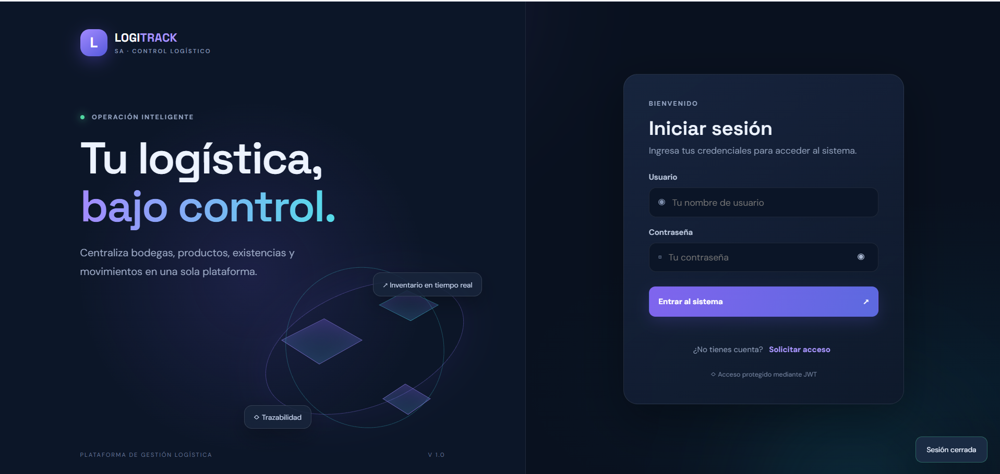
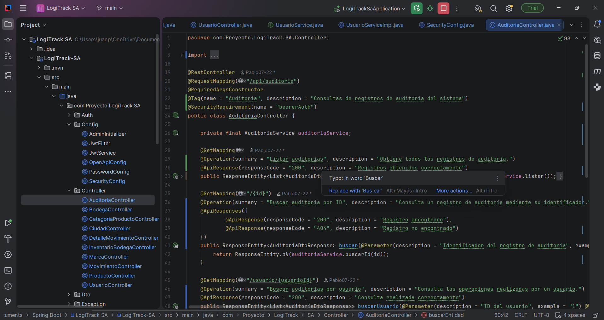

# 🚀 LOGITRACK SA

### 📦 Sistema de Gestión y Auditoría de Bodegas

**Controla. Gestiona. Audita.**


---

## 📌 1. Sobre el proyecto

**LogiTrack SA** es un sistema web desarrollado para gestionar y controlar las operaciones de inventario de una empresa que administra múltiples bodegas ubicadas en diferentes ciudades.

La aplicación permite centralizar la información de productos, bodegas, usuarios e inventarios, facilitando el registro de movimientos de mercancía y el seguimiento de las operaciones realizadas.

Además, incorpora mecanismos de autenticación mediante JWT, control de acceso por roles y un módulo de auditoría para registrar los cambios efectuados en el sistema.

## 🎯 2. Objetivo general

Desarrollar un sistema de gestión y auditoría de bodegas que permita registrar y controlar las transacciones de inventario, administrar productos y generar registros auditables de los cambios realizados por cada usuario.

## 🛠️ 3. Tecnologías utilizadas

| Tecnología | Descripción |
|---|---|
| ☕ Java 21 | Lenguaje de programación |
| 🍃 Spring Boot 4.1.2 | Framework backend |
| 🗄️ MySQL 8.0.46 | Base de datos relacional |
| 🔐 Spring Security | Seguridad y autorización |
| 🎫 JWT | Autenticación mediante tokens |
| 📦 Spring Data JPA | Persistencia de datos |
| 🧩 Hibernate | ORM |
| 🧰 Maven | Gestión de dependencias |
| 🌐 HTML5 | Estructura del frontend |
| 🎨 CSS3 | Diseño e interfaz |
| ⚡ JavaScript | Lógica e interacción del frontend |
| 📖 Swagger / OpenAPI | Documentación de la API |

## ✨ 4. Funcionalidades del sistema

### 👤 Gestión de usuarios

- Registro de solicitudes de nuevos usuarios.
- Inicio de sesión con autenticación JWT.
- Administración de usuarios.
- Aprobación y rechazo de solicitudes.
- Control de permisos según el rol.
- Roles disponibles: `ADMIN` y `EMPLEADO`.

### 🏢 Gestión de bodegas

- Registrar nuevas bodegas.
- Consultar bodegas existentes.
- Actualizar información.
- Eliminar bodegas.
- Asociar bodegas con ciudades y encargados.
- Registrar la capacidad de almacenamiento.

### 📱 Gestión de productos

- Crear productos.
- Consultar productos.
- Actualizar información.
- Eliminar productos.
- Asociar marcas y categorías.
- Registrar precios unitarios.

### 📊 Gestión de inventario

- Consultar existencias por bodega.
- Visualizar productos almacenados.
- Controlar cantidades disponibles.
- Identificar productos con stock bajo.
- Evitar existencias negativas.

### 🔄 Movimientos de inventario

El sistema permite realizar tres tipos de movimientos:

| Movimiento | Descripción |
|---|---|
| 🟢 ENTRADA | Ingreso de productos a una bodega. |
| 🔴 SALIDA | Retiro de productos de una bodega. |
| 🔵 TRANSFERENCIA | Traslado de productos entre bodegas. |

Cada movimiento registra:

- Fecha y hora.
- Tipo de movimiento.
- Usuario responsable.
- Bodega de origen.
- Bodega de destino.
- Observaciones.
- Productos y cantidades.

### 📝 Auditoría

El sistema cuenta con un módulo para registrar operaciones realizadas sobre las entidades.

Se almacena:

- Tipo de operación: `INSERTAR`, `ACTUALIZAR`, `BORRAR`.
- Fecha y hora.
- Usuario responsable.
- Entidad afectada.
- ID del registro.
- Valores anteriores.
- Valores nuevos.

### 🔐 Seguridad

- Autenticación mediante JWT.
- Protección de endpoints REST.
- Control de acceso por roles.
- Restricción de operaciones administrativas.
- Gestión de solicitudes de usuarios pendientes de aprobación.

## 🏗️ 5. Arquitectura del proyecto

El backend está organizado mediante una arquitectura por capas para separar las responsabilidades y facilitar el mantenimiento del código.

```text
📦 LogiTrack-SA
 ┣ 📂 src
 ┃ ┗ 📂 main
 ┃   ┣ 📂 java
 ┃   ┃ ┗ 📂 ...
 ┃   ┃   ┣ 📂 Model
 ┃   ┃   ┣ 📂 Dto
 ┃   ┃   ┃ ┣ 📂 Request
 ┃   ┃   ┃ ┗ 📂 Response
 ┃   ┃   ┣ 📂 Mapper
 ┃   ┃   ┣ 📂 Repository
 ┃   ┃   ┣ 📂 Service
 ┃   ┃   ┃ ┗ 📂 Impl
 ┃   ┃   ┣ 📂 Exception
 ┃   ┃   ┣ 📂 Auth
 ┃   ┃   ┗ 📂 Config
 ┃   ┗ 📂 resources
 ┃       ┗ 📄 application.properties
 ┣ 📄 pom.xml
 ┣ 📄 mvnw
 ┣ 📄 mvnw.cmd
 ┗ 📄 README.md
```

### 🌐 Frontend

El frontend está desarrollado con tecnologías web básicas:

```text
📦 LogiTrack-Frontend
 ┣ 📄 index.html
 ┣ 📄 style.css
 ┗ 📄 app.js
```

*Los nombres de los archivos pueden variar según la organización de la carpeta frontend.*

## 🗄️ 6. Base de datos

El sistema utiliza MySQL para almacenar la información de la empresa.

Entre las entidades principales se encuentran:

- 🏙️ Ciudad
- 👤 Usuario
- 🏢 Bodega
- 🏷️ Marca
- 📂 Categoría de producto
- 📦 Producto
- 📊 Inventario de bodega
- 🔄 Movimiento
- 📋 Detalle de movimiento
- 📝 Auditoría

La base de datos utiliza relaciones entre entidades y restricciones para mantener la integridad de la información.

## ⚙️ 7. Requisitos de instalación

Antes de ejecutar el proyecto, es necesario contar con:

- ☕ Java JDK 21.
- 🗄️ MySQL Server 8.
- 🧰 Maven o Maven Wrapper.
- 💻 IntelliJ IDEA o un IDE compatible.
- 🌐 Visual Studio Code para el frontend.
- 🧭 Un navegador web.

## 🚀 8. Instalación y ejecución

### 1️⃣ Clonar o descargar el proyecto

Descargar el repositorio o los archivos del proyecto y abrir la carpeta del backend en IntelliJ IDEA.

### 2️⃣ Configurar MySQL

Crear la base de datos correspondiente y ejecutar el script SQL con las tablas, relaciones y restricciones del sistema.

Configurar la conexión en `application.properties`.

Ejemplo:

```properties
spring.datasource.url=jdbc:mysql://localhost:3306/logitrack
spring.datasource.username=${DB_USERNAME}
spring.datasource.password=${DB_PASSWORD}

spring.jpa.hibernate.ddl-auto=none
spring.jpa.show-sql=true
```

> ⚠️ Configura las variables de entorno con las credenciales correspondientes. No publiques contraseñas reales en el repositorio.

### 3️⃣ Ejecutar el backend

Desde la terminal ubicada en la carpeta del backend:

**Windows:**

```bash
.\mvnw.cmd spring-boot:run
```

**Linux / macOS:**

```bash
./mvnw spring-boot:run
```

El backend estará disponible en:

```text
http://localhost:8080
```

### 4️⃣ Ejecutar el frontend

1. Abrir la carpeta del frontend en Visual Studio Code.
2. Abrir el archivo HTML principal mediante Live Server.
3. Verificar que el backend esté funcionando.
4. Ingresar desde el navegador.

Por defecto, el frontend se comunica con:

```text
http://localhost:8080
```

> 💡 Si el backend está en otro computador, configura la IP de ese equipo, CORS y el firewall para permitir la comunicación.

## 🔑 9. Autenticación y autorización

El sistema utiliza dos roles principales:

| Rol | Descripción |
|---|---|
| 👑 ADMIN | Administración de usuarios y operaciones administrativas. |
| 👷 EMPLEADO | Acceso a las funcionalidades permitidas para empleados. |

### Endpoints de autenticación

| Método | Endpoint | Función |
|---|---|---|
| POST | `/auth/login` | Iniciar sesión |
| POST | `/auth/registro` | Registrar solicitud de usuario |

Los usuarios que se registran mediante el formulario público deben esperar la aprobación del administrador.

## 🔗 10. Endpoints principales

| Módulo | Endpoint |
|---|---|
| 👤 Usuarios | `/api/usuario` |
| 🏙️ Ciudades | `/api/ciudad` |
| 🏷️ Marcas | `/api/marca` |
| 📂 Categorías | `/api/categoria-producto` |
| 📦 Productos | `/api/producto` |
| 🏢 Bodegas | `/api/bodega` |
| 📊 Inventario | `/api/inventario-bodega` |
| 🔄 Movimientos | `/api/movimiento` |
| 📋 Detalles | `/api/detalle-movimiento` |
| 📝 Auditoría | `/api/auditoria` |

## 📖 11. Documentación Swagger

La API cuenta con configuración de documentación mediante Swagger / OpenAPI.

Permite:

- Consultar los endpoints.
- Revisar parámetros y respuestas.
- Visualizar los métodos HTTP.
- Probar operaciones de la API.
- Autorizar solicitudes mediante JWT.

**Acceso habitual a Swagger UI:**

```text
http://localhost:8080/swagger-ui/index.html
```

## 🛡️ 12. Validaciones y manejo de errores

El backend implementa validaciones para proteger la integridad de los datos.

Algunos controles incluyen:

- Campos obligatorios.
- Cantidades positivas.
- Validación de relaciones entre entidades.
- Control de existencias disponibles.
- Restricciones en movimientos.
- Protección de rutas según los roles.

También cuenta con manejo global de excepciones mediante `@ControllerAdvice` para responder a los errores de la aplicación.

---

# 🖼️ 13. Galería del sistema

En esta sección se agregarán las capturas de pantalla de la aplicación LogiTrack SA.





---

## 👨‍💻 14. Autoría

**Proyecto:** LogiTrack SA  
**Tipo:** Sistema de gestión y auditoría de bodegas  
**Backend:** Java + Spring Boot  
**Base de datos:** MySQL  
**Frontend:** HTML + CSS + JavaScript

## 🎓 15. Conclusión

LogiTrack SA busca optimizar la administración de bodegas y el control de inventarios mediante una plataforma centralizada que facilita el registro de productos, la gestión de existencias y el seguimiento de movimientos.

La integración de Spring Boot, MySQL, Spring Security y JWT proporciona una base para gestionar la información de manera organizada y controlar el acceso a las funcionalidades del sistema.

**📦 LogiTrack SA – Control y trazabilidad para una gestión eficiente de inventarios.**

---

🚀 **LOGITRACK SA**

*Gestionando inventarios, conectando bodegas y fortaleciendo el control.*
